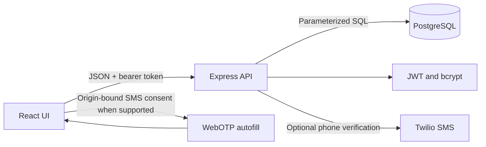

# Sweety — Blood Glucose Tracker

Standalone full-stack responsive web app. It is not part of the Rivo repository. The runnable source is in `server/` and `client/`; this guide explains the build and run steps. The original challenge’s required features are implemented: email/password auth with bcrypt, user-owned glucose readings, CRUD, validation, and daily/month-to-date/previous-month reports. The optional onboarding and OTP portions are limited to preference setup and optional phone verification. The interface works in a mobile browser; the assignment asks for React web, so this project does not build native iOS/Android packages.

> Health data in this demo is sensitive. Use fake data only. This is a tracking tool, not medical advice or a clinical system.

## Stack and prerequisites

- Node.js 24 LTS (or another maintained LTS line), npm, PostgreSQL 16+, and an editor.
- Express 5 API, PostgreSQL (`pg`), React + Vite, bcryptjs, JWT, Helmet security headers, and rate limiting.
- Optional SMS: Twilio Programmable Messaging credentials. Without these, all required email/password and glucose functionality works; SMS verification is disabled.

Install a maintained Node LTS: [Node.js releases](https://nodejs.org/en/about/previous-releases). Express 5 requires Node 18+: [Express installation](https://expressjs.com/en/5x/starter/installing/).

### Practices reused from the Rivo backend

The reference backend is Go, so its code and packages are not copied into this JavaScript assignment. Sweety uses the same useful ideas in its required stack: fail-fast environment validation, bounded request bodies, structured error codes plus request IDs, redacted error logs, auth-specific rate limits, versioned SQL migrations, owner-scoped data access, transaction locks for daily caps, and focused tests for edge cases. Redis, MongoDB, the event bus, and Rivo’s finance-specific layers would add setup without helping this small app.

## Step 1 — create database and backend

From this directory:

```sh
cd server
npm install
```

Create PostgreSQL role and database (run as a PostgreSQL administrator):

```sql
CREATE USER sweety_app WITH PASSWORD 'replace-with-a-local-password';
CREATE DATABASE sweety OWNER sweety_app;
```

Copy `server/.env.example` to `server/.env`, set `DATABASE_URL`, and generate `JWT_SECRET` with `node -e "console.log(require('crypto').randomBytes(48).toString('hex'))"`. Keep `.env` private. Required and optional environment variables are documented in the example file.

Apply the baseline schema through the migration runner:

```sh
cd server
npm run migrate
```

The runner tracks applied versions in `schema_migrations` and wraps each migration in a transaction. `schema.sql` is the initial version. Add later changes as new `server/migrations/NNNN_description.sql` files; do not edit an already-applied migration. The `TRUST_PROXY_HOPS` setting must match the actual reverse-proxy path; leave it at `0` for local development.

The backend has these files:

```text
server/
  package.json
  .env.example
  schema.sql
  src/server.js
  src/db.js
  src/auth.js
  src/config.js
  src/http.js
  src/readingRules.js
  src/readings.js
  scripts/migrate.js
  scripts/seed.js
  tests/api.test.js
  tests/config.test.js
  tests/readingRules.test.js
  tests/database.integration.test.js
  migrations/
```

## Step 2 — API and business logic

Start the API from `server/` using `npm run dev`. It listens on port 4000. `GET /api/health/live` checks the process; `GET /api/health` checks PostgreSQL readiness. All private requests require `Authorization: Bearer <token>`.

| Method | Endpoint                                | Purpose                                                     |
| ------ | --------------------------------------- | ----------------------------------------------------------- |
| POST   | `/api/auth/register`                    | `{name,email,password}` creates account and returns token   |
| POST   | `/api/auth/login`                       | `{email,password}` returns token                            |
| GET    | `/api/me`                               | current user and saved onboarding preferences               |
| PATCH  | `/api/me`                               | `{goal,preferredSlot,reminderEnabled}` saves onboarding     |
| GET    | `/api/readings`                         | caller’s readings only                                      |
| POST   | `/api/readings`                         | `{date,slot,value}` adds reading                            |
| PUT    | `/api/readings/:id`                     | changes an owned reading                                    |
| DELETE | `/api/readings/:id`                     | deletes an owned reading                                    |
| GET    | `/api/readings/reports?date=YYYY-MM-DD` | daily, month-to-date, prior-month statistics                |
| POST   | `/api/otp/request`                      | optional phone verification SMS; requires configured Twilio |
| POST   | `/api/otp/verify`                       | verifies SMS code and marks the user’s phone verified       |

Time slots: `morning`, `after_breakfast`, `after_lunch`, `after_dinner`. Values are whole mg/dL numbers from 40 through 600. One slot per day and at most four readings per day. The database unique key protects duplicate slots; an advisory transaction lock protects the four-reading limit during concurrent writes. Owner filtering happens in SQL for every read/update/delete. Errors include a readable `error`, stable `code`, and `requestId`; the frontend displays the readable message.

Reports return `null` high/low/average for an empty period and a count of zero. Daily includes the slot list. Averages round to one decimal. Dates are calendar-date strings, not timestamps.

## Step 3 — frontend and onboarding

In a second terminal:

```sh
cd client
npm install
```

Copy `client/.env.example` to `client/.env`, then run `npm run dev` and open the Vite URL shown in the terminal (usually `http://localhost:5173`). The interface is white with soft pink accents, responsive cards, form validation messages, and small entrance/hover animations. It honors `prefers-reduced-motion`.

### Open it on a phone on the same Wi-Fi

For manual UI testing on a physical phone, set `VITE_API_URL` in `client/.env` to `http://<computer-LAN-IP>:4000/api`, set `CLIENT_ORIGIN` in `server/.env` to the exact phone-facing web origin (for example `http://192.168.1.20:5173`), then start Vite with `npm run dev -- --host 0.0.0.0`. Keep `TRUST_PROXY_HOPS=0` when running locally and allow the development ports through the local firewall only on the trusted network. Plain HTTP on a LAN IP is not a secure context for WebOTP, so use manual code entry there; SMS auto-capture requires HTTPS and a compatible browser/device.

After account creation, a short onboarding asks the user’s tracking goal, a preferred logging slot, and whether they want a reminder preference saved. It does not send reminders (no scheduler/service is part of the challenge), and it does not ask the user to disclose a diagnosis. User can finish or skip it.

## Step 4 — auth, OTP and protection

- Passwords are hashed with bcrypt (12 rounds); plaintext is never stored or returned.
- Email is trimmed and lowercased. Password length is bounded. JWTs expire after seven days.
- Startup validates the database URL, JWT secret, port, CORS origin, optional Twilio settings, and proxy-hop count.
- JWT signing key is mandatory and must be at least 32 bytes.
- SQL uses parameters. Foreign keys cascade a user’s records on account deletion; the demo has no account-deletion UI.
- Reading date/value/slot checks happen in the API and in PostgreSQL. Frontend checks improve feedback but are not trusted.
- Optional SMS verification uses a short-lived hashed code, cooldown, attempt limit, and Twilio; do not expose provider secrets to Vite.
- SMS auto-fill uses `autocomplete="one-time-code"` and the WebOTP API when supported. Browser auto-retrieval requires a specially formatted origin-bound SMS, secure context, compatible device/browser, and user consent. Manual code entry always remains available. See [MDN WebOTP](https://developer.mozilla.org/en-US/docs/Web/API/WebOTP_API) and [MDN OTP guidance](https://developer.mozilla.org/en-US/docs/Web/Security/Authentication/OTP).
- Do not treat SMS alone as strong authentication; it is phone verification only. MDN advises against SMS OTP alone for new sessions. Passwords are the login method in this assignment.
- The bearer token is stored in localStorage for a simple learning project. Auth and OTP routes have in-memory rate limits; login attempts are keyed by both IP and normalized email, while OTP attempts also have an IP limit and a phone cooldown. This store is per-process and resets on restart. For production, use a security-reviewed session design (for example, HttpOnly/SameSite cookies with CSRF defenses), a shared rate-limit store, HTTPS, monitoring, tested account recovery, and a privacy review. Do not deploy this educational app with real patient data.

If OTP is enabled, set Twilio variables and the public app hostname in `server/.env`. Configure an SMS sender that supports the required final SMS line `@your-domain #123456`; some managed verification templates cannot guarantee this format. Localhost and unsupported browsers use manual entry. Twilio billing/verification may be required.

## Step 5 — seed, tests and Mermaid overview

Run `npm run migrate` then `npm run seed` inside `server/`; demo login is `demo@sweety.local` / `SweetyDemo123!`. Change or remove demo credentials before any public deployment. Seed is safe to rerun and updates sample values.

Run API checks with `npm test` inside `server/`; unit and HTTP checks do not require PostgreSQL. Set `TEST_DATABASE_URL` to a disposable local PostgreSQL database whose migrations have been applied to also run the integration test for concurrent insert limits, owner isolation, report summaries, and edits into a full day. Never point it at production or real patient data. Run a frontend production build with `npm run build` inside `client/`. Tests cover startup config validation, glucose/date/report rules, API auth errors, request IDs, malformed JSON, and daily-limit concurrency when a test database is configured.



## Step 6 — seed and run everything

Terminal A:

```sh
cd server
npm install
npm run migrate
npm run seed
npm run dev
```

Terminal B:

```sh
cd client
npm install
npm run dev
```

Open the Vite URL. Try registering, logging in, completing/skipping onboarding, recording four different slots on one date, trying the fifth slot/day limit, editing/deleting a record, and selecting dates to inspect all three reports. To test another account, register a second user and confirm their readings are isolated.

## Tests and submission checklist

```sh
# server
npm test

# client
npm run build
```

- [ ] Fresh database schema applied; seed works twice.
- [ ] Registration/login work; no password hash leaks; invalid credentials return generic errors.
- [ ] Two accounts cannot view or change each other’s readings.
- [ ] Blank, non-integer, under/over range, invalid/future date, duplicate slot and fifth/day are rejected with clear messages.
- [ ] Editing also preserves the unique-slot and daily-limit rules.
- [ ] Reports checked on empty ranges, month boundaries, January rollover, and rounded averages.
- [ ] `.env` excluded; `.env.example` has placeholders only; public repo contains no actual SMS credentials or personal data.
- [ ] Screenshot/video shows login, onboarding, reading CRUD, validation and reports.
- [ ] README Notes disclose assumptions and remaining production work; commits are small and truthful.

## Known limits and assumptions

This is an assignment-scale educational app. It uses localStorage bearer tokens, has no password reset/email verification, no CSRF/session-cookie architecture, no shared rate-limit store, no deployed SMS service configuration, and no actual reminder scheduler. The daily maximum uses a per-user/per-date PostgreSQL advisory transaction lock for create and edit operations, alongside the unique slot constraint. Add a concurrency integration test when a PostgreSQL test database is available. The app defines its date as the UTC calendar day so browser and API limits agree; a localized deployment should save each user's timezone and use it consistently in validation and report boundaries. The simple migration runner has no automatic down migrations; back up the database and write a reviewed forward migration. These are explicit follow-up tasks, not hidden behavior.

## Source files

The complete backend and frontend code are maintained in this directory and can be copied into an IDE as-is. `.env` files are intentionally not included; use the examples and your own local secrets.

